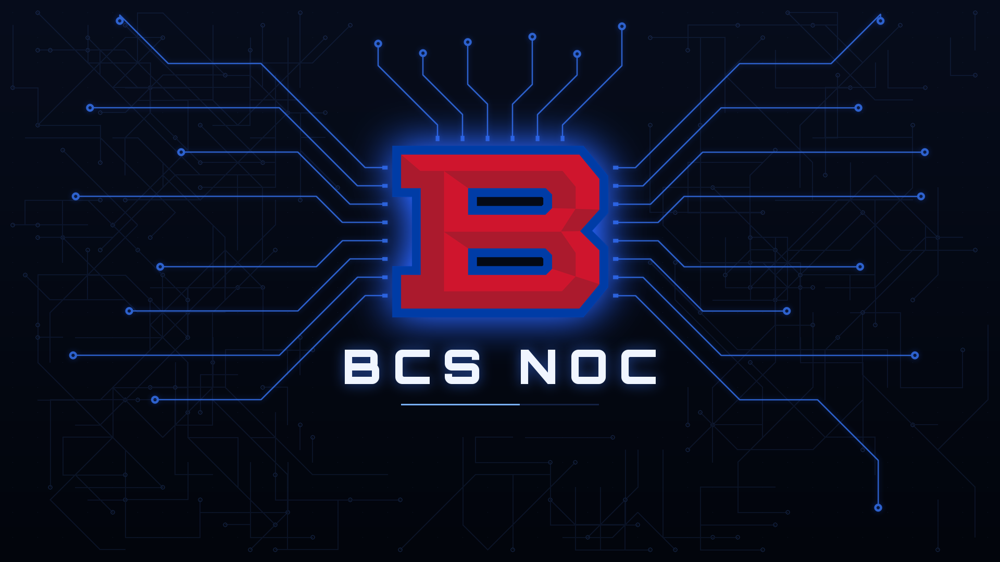

# BCS NOC display setup

Turns an Intel Mac mini running Ubuntu 26.04 into a BCS NOC dashboard display, and gives you one command (`noc`) to control every display at once.



## Set up a display

On the mini, with wired Ethernet plugged in, logged in as the account that should auto-login:

```bash
curl -fsSL https://raw.githubusercontent.com/tc21094/bcs-noc-display/main/install.sh | sudo bash -s -- --name noc-1 --url "https://your-dashboard"
```

Then `sudo systemctl reboot -i` (plain `sudo reboot` is blocked while the desktop is logged in). At the end it prints the line to register the display with `noc`.

What it does:

- Installs the Broadcom Wi-Fi driver (skipped if there's no Broadcom card or it already works)
- Installs the animated BCS NOC boot splash and a 4K desktop wallpaper
- With `--url`: auto-login, fullscreen Chrome on the dashboard, no screen blanking/lock/sleep, update and crash popups silenced, SSH, auto power-on after an outage, nightly 4 AM reboot, the BCS NOC interlude (below), and the `kiosk` / `noc` control commands

| Option | Effect |
|---|---|
| `--url URL` | Dashboard to show fullscreen (turns on kiosk setup) |
| `--name NAME` | Set the display's hostname, e.g. `noc-1` |
| `--interlude MIN` | Play the BCS NOC interlude every MIN minutes (default 30, `0` = off) |
| `--user NAME` | Account that auto-logs in (default: whoever ran sudo) |
| `--no-wifi` | Skip the Broadcom driver |
| `--no-splash` | Skip the boot splash and wallpaper |
| `--reboot` | Reboot when finished |
| `--gestures` | Camera gesture control on this display (see below) |
| `--airplay` | AirPlay wall receiver and player (see below) |

## Control every display with `noc`

Install on your Mac or Linux machine (each display also has it):

```bash
sudo curl -fsSL https://raw.githubusercontent.com/tc21094/bcs-noc-display/main/bin/noc -o /usr/local/bin/noc && sudo chmod +x /usr/local/bin/noc
```

One-time setup:

```bash
noc add noc-1 tc@10.0.0.21      # name, then login@address for each display
noc add noc-2 tc@10.0.0.22
noc add noc-3 tc@10.0.0.23
noc keys                        # password-free SSH (asks each display's password once)
```

Everyday use. `TARGET` is `all` (the default), a name, a number from `noc list`, or a list like `1,3`:

```bash
noc                     # status of every display
noc stop                # take manual control: dashboards close on all three
noc start               # put them back
noc reload 2            # reload display 2's page
noc restart 2           # restart Chrome on display 2
noc interlude           # play the BCS NOC interlude on every screen now
noc interlude every 20  # change how often it plays (0 = off)
noc blanket on          # "BCS Technology Department" on every screen until 'noc blanket off'
noc link                # let the bottom-left hot corner on any display toggle the blanket on all
noc blanket holiday     # the holiday version: snow, lights, a plow, and a cast of characters across the wall
noc blanket thanksgiving  # the Thanksgiving version: a turkey on the run, a deep fryer, a parade balloon ...
noc blanket theme auto  # pick by the calendar: Thanksgiving through Thanksgiving Day, holiday through Jan 6
noc url                 # what each display shows
noc url 2 https://...   # change display 2's dashboard (give several URLs to rotate)
noc rotate every 5      # rotate dashboards every 5 minutes, with a fade
noc disable 3           # keep display 3 off, even across reboots (noc enable 3 to undo)
noc reboot              # reboot all (asks first; the display you run it on goes last)
noc tv schedule "Mon-Fri 06:30-18:00"   # TVs off at night and on weekends
noc room on             # dim the wall when nobody's around; wake it when someone walks in
noc run all 'uptime'    # run any command everywhere
noc ssh 1               # shell on display 1
noc update              # re-run this installer on every display (asks for sudo password)
```

On a display itself, `kiosk help` lists the same controls (`kiosk stop`, `kiosk url ...`, etc).

A stopped dashboard comes back at the next reboot (including the 4 AM one). Use `disable` to keep it off.

## Rotating dashboards

Give a display several URLs and it rotates through them, fading to dark and back between each one:

```bash
noc url 2 https://grafana/d/core https://grafana/d/wifi https://unifi/dashboard
noc rotate every 5          # every display with more than one URL switches every 5 minutes
noc rotate 2 every 2        # or just display 2
noc next                    # switch now
noc rotate off              # stop rotating (noc next still steps through by hand)
```

Each dashboard stays open in its own background tab and keeps running, so the switch is instant and nothing reloads. That costs memory: each dashboard is a separate Chrome tab, so on a 4 GB display keep the list short. Switches happen on clock boundaries (every 5 minutes means :00, :05, :10 ...), so displays with the same interval switch together. Rotation pauses while the blanket is up and waits for an interlude to finish.

At setup: repeat `--url` for each dashboard and add `--rotate MIN`. Re-running the installer without `--url` keeps a display's current dashboards.

## BCS NOC interlude (burn-in protection)

Every 30 minutes, on the clock (:00 and :30), each display plays a 12-second full-screen animation over its dashboard, then fades back: circuit lanes route in from the screen edges toward the BCS B and spark at a small break around it, over a dot grid (style adapted from a colleague's maintenance-page animation, with our logo and colors). All displays play together because they follow the clock. The dashboard page keeps running underneath and is not reloaded.

It's drawn into the page through Chrome's DevTools pipe, so it works with any dashboard, including ones that refuse to be embedded or have strict security headers. It loads nothing from the network.

**Fall theme:** from September 22 through Thanksgiving (the fourth Thursday of November) the interlude switches itself to a fall version: maple and oval leaves tumbling down (a gust blows through halfway), autumn-coloured data pulses, a few leaves settling on the B and a drift of them along the bottom. The day after Thanksgiving it goes back to normal on its own, and it comes back every fall. It goes by each display's own date; nothing to turn on or off.

Change it with `noc interlude every N` (or `kiosk interlude every N` on a display). `0` turns it off. To change the length, edit the second number in `/etc/bcs-noc-interlude` (6-60 seconds).

## Blanket: "BCS Technology Department" on every screen

While the blanket is up, each display runs Chrome with only the blanket: the dashboards are closed so the animation never competes with them for memory or CPU, and they reload fresh when the blanket goes away. Expect a few seconds of the wallpaper while Chrome restarts each way.

```bash
noc blanket on        # all displays
noc blanket off
noc blanket toggle
noc blanket           # show which displays have it on
```

The blanket is the same scene with "BCS / TECHNOLOGY DEPARTMENT", and it stays up until it's turned off, including through page reloads and reboots. The whole scene drifts a few pixels over several minutes, so it can't burn in either. Scheduled interludes are skipped while it's up.

**Hot corner:** move the mouse into the bottom-left corner of any display to toggle the blanket. Run this once so a corner on any display toggles all of them:

```bash
noc link
```

`noc link` gives every display the same random key and the list of the others. The displays send each other signed messages (UDP port 47474), so nobody else on the network can trigger it. Before `noc link`, a hot corner only affects its own display. Run `noc link` again after adding or re-addressing a display.

### Holiday and Thanksgiving blankets

```bash
noc blanket holiday            # holiday blanket on every display
noc blanket thanksgiving       # Thanksgiving blanket on every display
noc blanket theme holiday      # make holiday the theme for 'noc blanket on' and the hot corner
noc blanket theme auto         # let the calendar pick: Thanksgiving from Nov 1 through Thanksgiving Day,
                               # holiday from the day after through Jan 6, the regular blanket otherwise
noc blanket theme standard     # back to the regular blanket
noc blanket show               # this season's show blanket with the action starting right away
noc blanket show thanksgiving  # ... or pick one: holiday | thanksgiving
noc wall                       # tell each display where it sits, left to right
```

With `auto` the blanket switches over by itself the day after Thanksgiving, even while it's up.

**Holiday**

Same scene, plus:

- falling snow (some behind the logo, some in front) and snow settled on the B
- twinkling lights across the top and red/green/gold data pulses
- snow that piles up along the bottom, and a BCS snow plow that clears it every 8 minutes, left to right across the whole wall, pushing a growing pile in front of its blade
- a vintage camper buried in a snowbank on the last display, dug out when the plow comes through (lights blink on, the stovepipe smokes), then slowly snowed in again
- a guy who fixes a dark gap in the lights at a random spot, three times every 8 minutes, badly: the ladder falls over before he can climb it, he nearly comes off halfway up, and the lights zap him when he plugs them in (flash, sparks, hair standing up, hat popped off, seeing stars), then the whole string surges on
- every time the ladder guy gets zapped, the surge overloads every light on the wall and the B: they flare white-hot, flicker, pop and go dark. A heavy-set maintenance guy with a flashlight comes looking for the fuse box at the bottom of the middle display, walks right past it in the dark, scratches his head, comes back, bends over to reset it (plumber's crack included), gets a jolt on the first try, and the second flip brings everything back. He gives the lights a thumbs up, hitches his pants and leaves
- the camper's owner (striped pajamas, nightcap, coffee mug). Once a cycle he pops out of the roof hatch, strings a ridiculous number of lights all over the camper and plugs them all into one power strip: everything flares, the strip sparks and smokes, the lights brown out across the whole wall, and that leaves the dark gap the ladder guy comes to fix. When the plow digs the camper out he waves his mug at it from the window, then steps outside just in time for the snow on the roof to slide off and bury him up to his neck
- two kids playing in the snow on the first display. When the ladder guy gets zapped, the surge races along the lights to the camper's satellite dish, which beams it into the snow and boots up two snowmen on the last display (blue LED eyes flicker on; the owner pops out of the hatch to stare), and they start a snowball fight with the kids, with snowballs arcing across every screen in between. Hits knock a kid flat or pop a snowman's head off. The kids run home just before the plow comes through; the snowmen don't, and get bulldozed

**Thanksgiving**

Same scene in autumn colors, plus:

- leaves tumbling down (some behind the logo, some in front) and a carpet of them along the bottom, a harvest moon over the first display, a garland of paper pennants and warm bulbs across the top, and the B wearing a pilgrim hat with a few leaves settled on it
- Tom the turkey, pottering about and pecking by the scarecrow, the hay bale and the pumpkins on the first display. A crow lands on the scarecrow's arm, the scarecrow slowly turns its head to look at it, and the crow leaves in a hurry
- Grandpa, out cold in his recliner in front of the game on the middle display, snoring (Z's), all cycle long
- backyard football: a kid on the first display throws long bombs to an uncle in a number 1 jersey on the last display, over everything in between. He catches some (and dances), takes some off the head (seeing stars), dives into the leaves for others (leaves everywhere), and now and then one lands on Grandpa
- Dad deep-fries the turkey - still frozen - on the last display: safety goggles, oven mitts, a propane burner. He lowers it in, and FWOOSH: a fireball, Dad blown flat on his back with a sooty face, Grandpa jolts awake, and the flaming bird rockets across the whole wall and lands next to Tom, who faints (legs in the air). Dad sits up blinking, grabs the extinguisher, puts out the pot, and the hose whips round and foams him too. He shuffles back inside as a foam blob
- a giant turkey parade balloon drifts across the top of the wall with two handlers holding the ropes. A gust lifts them off their feet; the balloon snags on the chimney, pops, zips around the wall and ends up draped over the roof
- the Cook (chef's hat, roasting pan) comes out of the house looking for Tom and walks across the wall to find him. Tom's disguise: glasses, a big nose, a mustache and a NOT A TURKEY sign, whistling innocently. It works until the mustache falls off. The chase runs right across the wall; the Cook trips (the pan goes up and comes down on his head, BONG), Tom hides behind the house - and a pizza scooter pulls up. Tom ordered it. Tom and the Cook share it on the porch steps, then Tom waddles home with a slice
- a BCS groundskeeper leaf-blows the whole wall clean, left to right, pushing a growing pile of leaves ahead of him (Tom hops over it). He piles everything up at the far end, admires it, and a gust blows every last leaf back across the wall and buries him up to his ears

Everything runs off each display's clock, so the displays stay in step without talking to each other. `noc blanket show` picks this season's show (the holiday one outside November). The holiday show turns the blanket on just before the camper guy starts stringing lights (about 10 seconds in), then the ladder guy (about 40 seconds), the snowball fight (about 1:20) and the plow (about 5 minutes). `noc blanket show thanksgiving` starts with Dad and the fryer (about 5 seconds in, the fireball at about 20), then the parade balloon (about 1:10), the turkey chase (about 2:50), the pizza (about 4:35) and the leaf blower (about 5:40).

**Tuning the hand-off.** The plow and the snowballs treat the gap between TVs (bezels plus the space between them) as real distance, so they leave one screen a moment before they reach the next. If they show up on the next screen too early, raise the gap; too late, lower it. The gap is a percentage of one screen's width (default 8):

```bash
noc wall gap 15
```

It applies within a couple of seconds, no restart.

**Clocks.** The linked displays (`noc link`) keep their own shared wall clock: every 10 seconds each one asks the others for their time and uses the median, so one display with a wrong clock is corrected without depending on internet time servers. With two displays they meet in the middle. `noc clock` shows, for each display, its internet time sync, how far its clock is from the others and which displays answered, and its clock as measured from the machine you run `noc` on ("in step", or "this clock is 6.00 s behind the others; the animations correct for it"). The interlude and rotation schedules use the same shared clock.

For the plow and snowballs to cross in the right order, `noc list` must be in left-to-right order on the wall. `noc link` runs `noc wall` for you; run `noc wall` again if you reorder the list (edit `~/.config/noc/hosts`).

## Camera gestures (center display)

A USB webcam on top of the center TV lets people control the whole wall by hand, all three displays from the one camera: a cursor to hover over things on the dashboards, zoom, flip between dashboards, pause rotation, play the interlude, and put the blanket up or down. Hand tracking runs on the display itself (Google MediaPipe); camera frames are never saved or sent anywhere.

**Set up** (on the center display, webcam plugged in):

```bash
curl -fsSL https://raw.githubusercontent.com/tc21094/bcs-noc-display/main/install.sh | sudo bash -s -- --gestures
sudo systemctl reboot -i
```

It installs the hand tracker (about 600 MB) and turns gestures on. Re-running the installer later (`noc update`) keeps them.

**Gestures**

| Do this | What happens |
|---|---|
| Hold an open palm up, facing the screen, still, for about a second | Wakes it: a cursor appears in the middle of the screen. A ring at the top fills while you hold. |
| ...and keep it still for about 2 more seconds | A **help card** with every gesture. Move your hand to close it. |
| Move that hand | The cursor follows, across all the displays: move slowly for precise pointing, sweep quickly to cross to the next screen (it speeds up like a mouse). Resting it on something hovers it, so tooltips and highlights show as they would with a mouse. |
| Quick pinch and let go (a tap) | Click whatever the cursor is on, like a mouse click (a blue ripple shows where) |
| Pinch (thumb and index together), then raise or lower your hand | Zoom in or out around the cursor. Let go to stop. **Over a map or zoomable chart** (Grafana Geomap, Leaflet, Mapbox / MapLibre, OpenLayers, Google Maps, ArcGIS, Highcharts, ECharts, Plotly, or anything else that zooms with the mouse wheel) the map itself zooms, about one level for each doubling of the pinch, like turning a mouse wheel; the cursor shows "zoom map" (a map embedded from another site in a frame gets the magnify instead). **Anywhere else** the page is magnified (up to 4x); while magnified, resting the cursor near an edge pans. |
| Quick flick of the open hand left / right | Next / previous dashboard on the display the cursor is on |
| Make a fist and **flick it** left / right | **Throw** the dashboard under the cursor to the next TV that way. It flies across and opens there for 10 minutes (longer while someone's using it), then that TV goes back to its own dashboards. On the TV it landed on: an open-hand flick sends it away now, a held fist keeps it for 30 minutes. The cursor goes along with it. |
| Make a fist and hold it (about a second, a ring fills) | Pause rotation on the display the cursor is on, or resume it. A pause ends by itself after 30 minutes. |
| Hold a "V" (index and middle finger) | Play the BCS NOC interlude on every display |
| Hold a **thumbs up** (about a second) | **Spotlight**: every TV dims except a bright circle around the cursor, for pointing something out to a room. Thumbs up again (or walk away) to turn it off. |
| Point one finger and hold it **still** (about 1.5 s, a red ring fills) | Drawing on: point to draw in red on whichever screen the cursor is on, open your hand to lift the pen and move, point again to draw more. Hold a fist to clear the drawing and stop. While drawing, taps, zoom and flicks are off; the drawing fades 30 seconds after you walk away. |
| Hold up **both** open palms (about 1.5 seconds) | Blanket on / off on every linked display, same as the hot corner. Works while the blanket is up. |
| Hold up **both fists** (about 3 seconds, a red ring fills on every TV) | **Reboot every display.** A 5-second countdown shows on every TV first: show an open hand to cancel. The camera display tells the others and waits until each one confirms, then reboots itself last. |
| Drop your hand | The cursor goes away after 3 seconds; the zoom resets 20 seconds later. |

**Fitted to each person.** For the first few seconds after someone wakes it, it watches how far they move their hand, then sets the cursor speed so their comfortable reach covers the wall: someone who keeps their hand close gets a faster cursor (up to 1.6x), someone with long sweeping moves a calmer one (down to 0.8x). It starts fresh for the next person. The camera preview shows what it chose.

A thrown dashboard opens in that TV's own browser, so a page that needs a login only shows if that TV is logged in to it as well.

It's built for a room where people walk past the camera: nothing responds until someone holds a raised, open palm still for a second, close to the camera. Hands that are moving, hanging at someone's side, turned sideways, or farther than about 2.8 m are ignored, and once someone has the cursor, another hand passing through doesn't take it. Rotation holds still while someone is using the cursor, and zoom resets when the dashboard changes.

A small dot in the top-right corner shows the camera is on: grey while waiting, blue while someone is using it, red with "no camera" if it can't find one.

**Controls**

```bash
noc gestures                   # on/off, frames per second, hands in view, for each display
noc gestures 2 preview         # show what the camera sees (with the hand tracking drawn on) in a corner, 10 minutes
noc gestures 2 preview off
noc gestures 2 range 3.5       # act on hands up to 3.5 m from the camera (default 2.8)
noc gestures 2 camera /dev/video2
noc gestures 2 size 640x480     # camera resolution (default 1280x720; tracking itself runs at 640 wide)
noc gestures 2 record 30       # save 30 s of hand positions (no pictures) to the display's home folder, for tuning
noc gestures 2 off             # camera off; 'on' to turn it back on
```

The cursor reaches the other displays over the same link as the hot corner, so `noc link` must have been run, and `noc list` must be in left-to-right order (`noc wall`).

**How it recognises an open hand.** It uses Google's trained gesture classifier (it knows an open palm, a fist, a V and a pointing finger from a large set of real hands) together with its own check of which fingers are straight, measured in 3D so a hand tipped toward the camera still counts. It needs the hand to read as open for most of about half a second, so one bad frame doesn't spoil a hold. In the preview, each hand shows what it was read as, the classifier's verdict and confidence, which fingers it sees straight (I M R P, green), and the wake checks.

Tips: put the camera at the top center of the TV, angled slightly down at where people stand. Light from the front helps a lot in a dim room. Use `preview` to check what it sees: under each hand it lists what it needs before it will wake (open, upright, near, still) in green when met and red when not, and `noc gestures` says the same in words. A 1080p webcam like a Logitech C920 works well; a higher-resolution camera doesn't track better, because the tracker works on a 640-pixel-wide picture either way. The hand tracker uses about one CPU core. `noc gestures` shows the camera's frame rate and how many frames a second the tracker keeps up with.

## TV power schedule

The displays can switch their TVs off at night and on weekends, and back on in the morning:

```bash
noc tv schedule "Mon-Fri 06:30-18:00, Sat 08:00-12:00"   # TVs on during these hours
noc tv                                                    # how each display switches its TV, and what it's doing
noc tv off                 # TVs off now (until the schedule next turns them on); 'noc tv on' likewise
noc tv auto                # back to the schedule
noc tv test 2              # display 2's TV off for 10 seconds, then on: does it work?
noc tv schedule off        # no schedule: the TVs are left alone
```

Schedules take day ranges and lists (`Mon-Fri`, `Mon,Wed,Fri`, `weekdays`, `weekends`, `daily`) and times like `06:30`, `18:00`, `6pm` or `8-5` (8 AM to 5 PM); `Fri 22:00-02:00` runs past midnight. Without a schedule (and without `noc tv on|off` or the room setting below) the displays never touch the TV.

**How a display switches its TV.** Each display uses the best way it has (`noc tv` says which):

| Method | What it needs |
|---|---|
| `cec` | HDMI-CEC from the computer's own video output. On most computers, Macs included, the built-in HDMI port doesn't carry CEC (`noc tv` checks). Some *active* DisplayPort-to-HDMI adapters pass CEC through and show up in Linux as `/dev/cec0`; for the Mac minis' Thunderbolt 2 (mini DisplayPort) ports the Linux CEC documentation lists the **Club3D CAC-1180** mini DisplayPort to HDMI adapter as working. Passive adapters never do. |
| `cec-usb` | A USB-CEC adapter (Pulse-Eight) between the computer and the TV: works with any computer. |
| `custom` | Your own on / off commands, e.g. the TV's network control: `noc tv command on 'curl ...'` and `noc tv command off 'curl ...'` |
| `screen` | Nothing else available: the display turns its video signal off. The TV shows "no signal" and goes to its own standby after a while; whether it comes back on by itself when the signal returns depends on the TV (look for a setting like "auto power on" or "wake on HDMI signal"). |

`noc tv method cec|cec-usb|screen|custom` forces one; `auto` (the default) picks.

## Room-aware dimming

The camera on the center TV can tell when nobody's around, and the whole wall reacts:

```bash
noc room on                # turn it on (on every display)
noc room after 20          # minutes with nobody around before it acts (default 15)
noc room action dim        # dim the screens (default), or: noc room action tvoff
noc room sensitivity low   # if it wakes for nothing (or 'high' if it misses people)
noc room                   # what it's doing
```

When nobody has moved in view of the camera for that long, every screen fades to nearly black (or the TVs turn off), with a small "the wall wakes up when someone comes in" line. As soon as someone walks in or raises a hand, everything comes back.

With a TV schedule, it also works the other way: outside the scheduled hours, someone walking in turns the TVs on, and they go off again once the room has been empty for the same time.

It looks for movement in a tiny 64 x 36 grey version of the camera picture, compared twice a second against the brightness around each spot, so the room getting lighter or darker (the TVs dimming, the lights going off, the camera adjusting) doesn't count as someone walking in. Nothing is recorded or kept. Someone sitting very still for the whole time can be missed; a longer `after` helps. It needs the gesture camera running on the center display (`noc gestures`); if the camera stops, nothing dims.

## AirPlay: the wall as one display

Macs, iPhones and iPads see the whole wall as one AirPlay display, "BCS NOC Wall". On a Mac, pick it in Control Center > Screen Mirroring and choose to use it as a **separate (extended) display**: the Mac gets one very wide screen that spans the three TVs, so you can drag windows across the wall or put something different on each TV. Mirroring a screen (Mac, iPhone, iPad) shows it on the middle TV. When the device disconnects, the dashboards come back; rotation and the interlude hold while a picture is up.

**Set up** (every display, then turn the receiver on once):

```bash
noc update --airplay            # or: curl ... install.sh | sudo bash -s -- --airplay   on each display
noc airplay on                  # the receiver runs on the middle display; prints the pairing code
```

The middle display runs the AirPlay receiver (UxPlay) and forwards the video, still compressed, to every display; each one decodes it and shows its own slice, with the bezel gap from `noc wall gap` hidden behind the bezels so lines stay straight. The first time a device connects, the middle TV shows a 4-digit code to type on it; after that it's remembered.

**Resolution** (the Mac must reconnect after a change):

```bash
noc airplay res next            # step through the sizes: 540 -> 720 -> 1080 -> 540 ...
noc airplay res 720             # or pick one
noc airplay                     # what it's set to now, and whether something is showing
noc airplay mode center         # the middle TV only, as an ordinary display (better for mirroring)
noc airplay mode wall           # back to one display across the wall
```

| Setting | Wall mode (per TV) | What to expect |
|---|---|---|
| `540` | 960x540 | Lightest and smoothest; text is soft from across the room |
| `720` (default) | 1280x720 | The best that works with any Mac and these minis (H.264) |
| `1080` | 1920x1080 | Sharpest. Needs a Mac that sends H.265, and minis fast enough to decode a 6000-pixel-wide H.265 picture; try it, and step back to 720 if it stutters |

In center mode the sizes are 720, 1080 and 2160 (4K, H.265) for the middle TV.

Other settings: `noc airplay pin 1234` (or `pin new`, `pin off`), `noc airplay name "NOC Wall"`, `noc airplay off`.

**Finding the wall:** it's announced two ways. On the network (Bonjour), which only reaches the displays' own network segment, and over **Bluetooth Low Energy** from the middle display, which reaches any Mac, iPhone or iPad in the room whatever network it's on (UxPlay's beacon). Either way, the device then connects to the middle display's address, so its network must be able to reach that address (TCP 7000, 7001, 7100). The Mac mini's built-in Bluetooth is used; if it has none or it isn't detected, a USB Bluetooth 4.0+ dongle works. `noc airplay` shows whether each announcement is working; `noc airplay bluetooth off` turns the Bluetooth one off. Protected video (the Apple TV app) shows black. Expect about half a second of delay.

## Keeping the clocks right

`noc clock` shows whether each display's clock is synced. Ubuntu 26.04 gets the time from Ubuntu's secure time servers (NTS), which need TCP port 4460 and UDP port 123 out to the internet; school and business networks often block them, and then every display says NOT SYNCED. The TV schedule and the holiday shows run on each display's own clock, so it's worth fixing:

```bash
noc timeserver          # each display tests what answers: the server the network hands out, the domain
                        # controllers, the router, the DNS servers, and public time servers
noc timeserver auto     # use the best ones that answer (asks for each display's sudo password)
noc timeserver 10.1.2.3 # or a specific one, e.g. the district's time server
noc timeserver default  # back to Ubuntu's own
noc clock               # should now say synced
```

If `noc clock` still says NOT SYNCED, it lists every time source and what's wrong with it (no reply, disagrees with the others, or answers but too vague). Windows domain controllers often report that their own time could be several seconds out, and chrony ignores such servers by default; `noc timeserver auto` (or naming the server) notices and allows it. And while Ubuntu's secure servers are configured, chrony won't let plain time servers set the clock on their own, so when the network blocks the secure ones nothing gets used at all (Ubuntu bug 2155165); `noc timeserver` checks whether they're reachable and, if not, lets the plain servers count (`authselectmode ignore`).

If nothing answers at all, the network blocks time traffic outright: ask for the district's internal time server (usually a domain controller) and use `noc timeserver ADDRESS`. Even while unsynced, the displays still agree with each other for the animations (the "wall clock" line of `noc clock`).

## Upgrading a display that ran an older version

```bash
curl -fsSL https://raw.githubusercontent.com/tc21094/bcs-noc-display/main/install.sh | sudo bash -s -- --name noc-1
sudo systemctl reboot -i
```

Without `--url` it keeps the dashboards the display already has. If the display was set up with the very first `kiosk-setup.sh`, add `--url` with its dashboard.

## Rebuilding

`src/` holds the boot theme and wallpaper generators, `bin/` the control scripts. With python3, pillow, numpy and scipy:

```bash
cd src && ./make_installer.sh   # writes ../install.sh
```

Recordings: `docs/bcs-noc-boot-preview.mp4` (boot splash), `docs/bcs-noc-interlude-preview.mp4`, `docs/bcs-blanket-preview.mp4`, `docs/bcs-holiday-blanket-preview.mp4` (two displays side by side). Orbitron font: SIL Open Font License.
